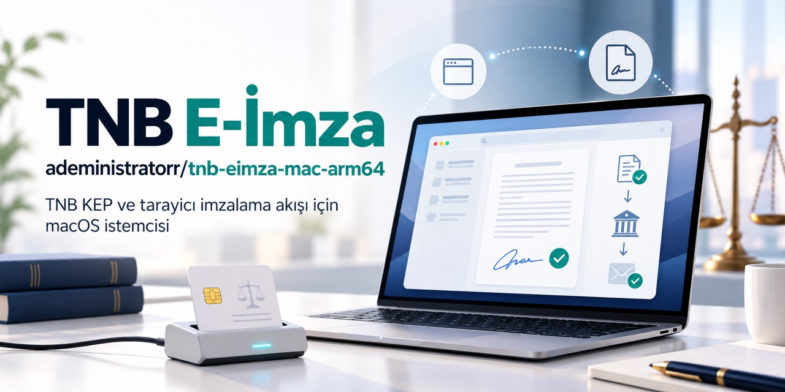

# TNB Teknoloji E-imza — macOS Apple Silicon kurulumu

> **Kısa yanıt:** Türkiye Noterler Birliği KEP girişinde (`kep.hs02.kep.tr`) kullanılan TNB Teknoloji Elektronik İmza uygulamasını Mac'inizde çalıştırmak mı istiyorsunuz? Üretici yalnızca Windows kurulumu dağıtıyor; bu proje aynı uygulamayı **MacBook, MacBook Pro, MacBook Air, Mac mini ve iMac**'de (Apple Silicon / M serisi / ARM tabanlı işlemci) native `.app` + Chrome **native messaging host** olarak çalıştırır. Gömülü arm64 Java 11 sayesinde Rosetta veya ayrı Java gerekmez. **Gayriresmî topluluk portudur; TNB veya üretici tarafından onaylanmamıştır.**
>
> **Chrome eklentisi zorunlu:** [TNB Teknoloji Elektronik İmza (Chrome Web Store)](https://chromewebstore.google.com/detail/ppgjmopocehhllbjblnpdajkkkfghpan) — kurduktan sonra Chrome'u tamamen kapatıp açın.

## İlk kez kuranlar için

1. **Chrome eklentisi:** Yukarıdaki bağlantıdan kurun; ardından Chrome'u tamamen kapatıp yeniden açın.
2. **Uygulama:** [Releases](../../releases) → `TnbEimza-arm64-*.dmg` (en hızlı) veya `brew install --cask adeministratorr/tap/tnb-eimza`.
3. **Kart ve sürücü:** e-imza kartı + kart okuyucu + **arm64 AKİS sürücüsü**: [akiskart.bilgem.tubitak.gov.tr/destek](https://akiskart.bilgem.tubitak.gov.tr/tr/destek/) → "Mac OS Arm (Apple Silicon)". Kontrol: `lipo -archs /usr/local/lib/libakisp11.dylib` → `arm64`.
4. **Başarılı kurulum:** `kep.hs02.kep.tr` girişinde sertifika seçimi → PIN → imzalama akışı tamamlanır.
5. **Sık hata:** Eklenti "uygulama kurulu değil" diyorsa Chrome'u tamamen kapatıp açın; sertifika listesi boşsa arm64 sürücüyü kontrol edin. Gatekeeper uyarısı → notarize DMG'de beklenmez; kaynaktan derlemede sağ tık → **Aç**.
6. **Önemli sınır:** Gerçek **AKİS** kartıyla uçtan uca doğrulandı; diğer token'lar (SafeNet, SafeSign, IDPrime, OpenSC) sürücü listesinde olmasına rağmen donanım olmadığı için test edilmedi. `decrypt` akışı da gerçek şifreli iletiyle denenmedi. Intel Mac desteklenmez. PIN'inizi hiçbir komuta/issue'ya yazmayın.

> **Güvenlik notu:** Bu port resmî/üretici onaylı değildir. DMG sürümü Developer ID ile imzalı ve Apple notarizasyonundan geçmiştir; sürüm notlarında `sha256` bulunur. Kaynaktan derleme ad-hoc imzalıdır; `kur.sh` betiğini çalıştırmadan önce inceleyin.

## Kimler için?
- **Noterler ve noterlik çalışanları:** kep.hs02.kep.tr üzerinden e-imza ile giriş yapanlar (noter işlemleri ve resmî yazışmalar).
- **Hukuk ve kurum profesyonelleri:** TNB imza gerektiren akışlarda Chrome eklentisini kullananlar.
- **Şirket yetkilileri ve mali müşavirler:** KEP/e-tebligat yazışmalarını Mac üzerinden yürütenler.

## "Mac'te e-imza çalışmıyor" arayanlar için kısa cevaplar
- **Neden Mac'te çalışmıyor?** Üretici yalnızca Windows kurulumu veriyor; uygulamanın macOS sürümü yok. Bu port, uygulamayı arm64 Mac'te çalıştırır ve tarayıcıya kaydeder.
- **MacBook / MacBook Pro / MacBook Air / iMac / Mac mini'de çalışır mı?** Evet — Apple Silicon (M1/M2/M3/M4 ve sonrası). Intel desteklenmez.
- **Çift tıklayarak mı açılır?** Hayır — bu bir tarayıcı (native messaging) aracıdır; imzalama akışı **Chrome'dan** başlatılır.
- **İmza için ek olarak ne gerekir?** Chrome eklentisi + e-imza kartı + kart okuyucu + **arm64 AKİS sürücüsü** (yukarıda).

## Neden Mac'te çalışmıyordu? Nasıl çözdük?

- **Sorun:** TNB Teknoloji Elektronik İmza yalnızca Windows kurulumu (`TNBTeknolojiImza.exe`) olarak dağıtılıyordu; Mac sürümü yoktu.
- **Neden 1:** Jar içindeki IAIK PKCS#11 native kütüphanesinde `arm64` dilimi yoktu (yalnızca ppc/i386/x86_64) → kart erişimi `UnsatisfiedLinkError` ile düşüyordu.
- **Neden 2:** Uygulamanın sürücü listesinde Türkiye'de yaygın **AKİS** sürücüsü yoktu; kart takılı olsa bile sertifika listesi boş geliyordu.
- **Çözüm:** IAIK native katmanı yerine aynı API'yi **SunPKCS11** üzerine oturtan `sunpkcs11-wrapper` kullanıldı; eksik üyeler (örn. `Mechanism.RSA_PKCS`) shim ile eklendi; AKİS dahil genişletilmiş sürücü listesi tanımlandı ve `Module.finalize` sorunu giderildi.
- **Doğrulama:** Gerçek AKİS kartı ve PIN ile `kep.hs02.kep.tr` girişi (sertifika seçimi → PIN → imzalama) uçtan uca test edildi.

## Kurulum (3 yol)
1. **Hazır DMG (en hızlı):** [Releases](../../releases) → `TnbEimza-arm64-*.dmg`.
2. **Homebrew cask (hazır DMG, derleme beklemez):**

```bash
brew install --cask adeministratorr/tap/tnb-eimza
```

3. **Tek satır (kaynaktan derler; betiği önce inceleyin):**

```bash
curl -fsSL https://raw.githubusercontent.com/adeministratorr/tnb-eimza-mac-arm64/main/kur.sh | bash
```

> Chrome eklentisi ayrıca gereklidir: [TNB Teknoloji Elektronik İmza (Chrome Web Store)](https://chromewebstore.google.com/detail/ppgjmopocehhllbjblnpdajkkkfghpan) — kurduktan sonra Chrome'u tamamen kapatıp açın.

Diğer araçlar (aynı tap): [e-Devlet E-İmza](https://github.com/adeministratorr/edevlet-eimza-mac-arm64) · [PTT KEP Webmail](https://github.com/adeministratorr/pttkep-eimza-mac-arm64) · [PTT UETS / e-Tebligat](https://github.com/adeministratorr/uets-eimza-mac-arm64) · [UHAP İmzalama](https://github.com/adeministratorr/uhap-eimza-mac-arm64) · [UDF QuickLook](https://github.com/adeministratorr/udf-quicklook-extension) · [UYAP Doküman Editörü](https://github.com/adeministratorr/ude-mac-arm64-1)

---

## TNB Teknoloji Elektronik İmza — macOS (Apple Silicon) Portu

TNB KEP (`kep.hs02.kep.tr`) girişinde kullanılan **TNB Teknoloji Elektronik İmza**
uygulamasının Apple Silicon Mac'ler için **resmi olmayan, topluluk** portu.
Üretici yalnızca Windows kurulumu (`TNBTeknolojiImza.exe`) dağıtıyor; bu depo
aynı Java uygulamasını gömülü **arm64 Java 11** runtime ile native bir `.app`
olarak paketler ve Chrome'a *native messaging host* olarak kaydeder.
Rosetta veya ayrı Java kurulumu gerekmez.

Apple Silicon bir Mac'te, gerçek AKİS kartı ve PIN ile **`kep.hs02.kep.tr`
girişi uçtan uca çalıştığı doğrulanmıştır.**

## Kurulum (tek komut)

```bash
curl -fsSL https://raw.githubusercontent.com/adeministratorr/tnb-eimza-mac-arm64/main/kur.sh | bash
```

Betik sırayla: Xcode Command Line Tools'u (gerekirse) kurar, depoyu
`~/tnb-eimza-mac-arm64` altına klonlar, arm64 Java 11 runtime'ını indirir,
`TNBTeknolojiImza.app`'i derleyip imzalar, `/Applications`'a kurar ve kurulu tüm
Chromium tabanlı tarayıcılara kaydeder. İnternet gerekir.

Ardından:

1. Chrome eklentisini kurun (kurulu değilse):
   [TNB Teknoloji Elektronik İmza](https://chromewebstore.google.com/detail/ppgjmopocehhllbjblnpdajkkkfghpan)
2. **Chrome'u tamamen kapatıp yeniden açın** — kayıt ancak açılışta okunur.
3. https://kep.hs02.kep.tr adresinden e-imza ile giriş yapın.

## Bu uygulama çift tıklanarak açılmaz

Diğer e-imza portlarından farklı olarak bu bir **native messaging host**'tur:
tarayıcı, eklenti imzalama isteyince uygulamayı kendisi başlatır ve stdin/stdout
üzerinden JSON konuşur. `/Applications` içindeki uygulamaya çift tıklamak
beklenen bir şey yapmaz; akışı **tarayıcıdan** başlatın.

## Zorunlu: arm64 kart sürücüsü (PKCS#11)

Uygulama kartı `libakisp11.dylib` gibi bir PKCS#11 sürücüsü üzerinden okur ve
**arm64** kod olarak çalışır; Intel-only bir sürücü arm64 sürece yüklenemez.
AKİS kartları için TÜBİTAK BİLGEM'den **"Mac OS Arm (Apple Silicon)"** paketini
kurun:

- https://akiskart.bilgem.tubitak.gov.tr/tr/destek/

Doğrulama (`arm64` içermeli):

```bash
lipo -archs /usr/local/lib/libakisp11.dylib
```

Bilinen sürücü adları bilinen dizinlerde taranır ve **yalnızca diskte gerçekten
var olan** yollar denenir; liste ve arama dizinleri için bkz.
`patch/MacPkcs11Modules.java`. Listeyi geçici olarak değiştirmek için
`-Dtnb.pkcs11.modules=/yol/surucu.dylib`.

> **macOS 28 / Rosetta uyarısı:** Sistemde eski **Intel** AKİS paketi kuruluysa macOS, `/Applications/Akia.app` için "bu uygulama gelecek macOS sürümünde açılmayacak" uyarısı gösterir (Rosetta desteği macOS 28'de kaldırılıyor). TÜBİTAK'ın **Arm (Apple Silicon)** paketini kurduysanız yeni sürüm `Akia ARM.app` (arm64) olarak gelir; eski `/Applications/Akia.app`'i Finder'da Çöp'e sürükleyip kaldırın. Bu uyarı native messaging akışını etkilemez — kart erişimi yukarıdaki `libakisp11.dylib` üzerinden yürür.

## Teknik özet

Windows sürümü aslında saf bir Java uygulaması (`TNBTeknolojiImza.jar`) — `.exe`
yalnızca NSIS kurucusu. macOS'ta iki şey bozuk:

1. **Native kütüphanede arm64 dilimi yok.** Jar, kart erişimini IAIK PKCS#11
   Wrapper'ın native parçası üzerinden yapar; içindeki `libpkcs11wrapper.jnilib`
   yalnızca `ppc64 / ppc7400 / i386 / x86_64` içerir. arm64 JVM'de
   `UnsatisfiedLinkError` ile düşer.
   → **Çözüm:** IAIK'in native katmanı yerine aynı `iaik.pkcs.pkcs11` API'sini
   **SunPKCS11** (`jdk.crypto.cryptoki`) üzerine oturtan
   [`org.xipki.iaik:sunpkcs11-wrapper`](https://github.com/xipki/pkcs11wrapper/tree/sunpkcs11)
   kullanılıyor — saf Java, arm64 native, Rosetta yok.

2. **macOS modül listesinde AKİS yok.** Orijinal kod macOS'ta yalnızca
   `libeTPkcs11.dylib` ve `libaetpkss.dylib` deniyor; Türkiye'de yaygın olan AKİS
   sürücüsü listede değil — kart takılı olsa bile sertifika listesi boş gelir.
   → **Çözüm:** AKİS dahil genişletilmiş, dosya varlığına göre çözülen liste.

`sunpkcs11-wrapper` IAIK API'sinin birebir kopyası değil; uygulamanın çağırdığı
bazı üyeler orada yok. Bunlar `patch/Patch.java` içindeki **shim** ile geri
ekleniyor — en kritiği `Mechanism.RSA_PKCS`: sertifika listeleme `Mechanism`'e
hiç dokunmadığı için sorunsuz çalışıyor, ama **imzalama** tam olarak orada
`NoSuchFieldError` ile duruyordu. Eklenenler:

| Üye | Neden gerekli |
|---|---|
| `Mechanism.RSA_PKCS` (ve `RSA_X_509`, `RSA_9796`, `RSA_PKCS_OAEP`, `RSA_PKCS_KEY_PAIR_GEN`) | imzalama mekanizması |
| `Session.decrypt(byte[])` / `encrypt(byte[])` | şifreli KEP içeriği |
| `Functions.toFullHexString(int)` | PKCS#11 hata kodu → okunabilir mesaj (örn. `CKR_PIN_INCORRECT`) |
| `Module.getInstance(String,String)` | ölü dal; yalnızca doğrulayıcı için |

Bir de davranış farkı var: **`Module.finalize()` işlevsizleştirildi.** Uygulama
her istekte önce `deinitShell()` (modül başına `C_Finalize`) sonra `initShell()`
çağırıyor. SunPKCS11 ise modülü *yol başına önbelleklediği* ve `C_Initialize`'ı
yalnızca örneği ilk kez oluştururken çağırdığı için, `C_Finalize` sonrası
yeniden başlatma sessizce atlanıyor ve ikinci turdan itibaren her çağrı
`CKR_CRYPTOKI_NOT_INITIALIZED` veriyordu. Tek turluk `selectCertificate`
çalışıp çok turlu `sign` patladığı için fark edilmesi zordu. Host süreci tek
istek işleyip çıktığından `C_Finalize`'ı hiç çağırmamak zararsız; oturumlar
(logout + closeSession) kapatılmaya devam ediyor.

Bu tür bir eksik **derleme sırasında görünmez**, ancak kullanıcı o özelliği
çalıştırınca patlar. Bu yüzden derleme hattında iki zorunlu denetim var:

- `patch/ApiCheck.java` — uygulamanın çağırdığı **her** `iaik.*` üyesini sabit
  havuzundan çıkarıp yeni wrapper'da var mı diye bakar (125 referans).
- `patch/ShimTest.java` — shim'i yamalı jar'a karşı gerçekten çalıştırır
  (statik denetim `<clinit>` hatasını yakalayamaz) ve `deinit → init`
  döngüsünü 3 tur koşturarak yukarıdaki `C_Finalize` regresyonunu yakalar.

Diğer yamalar:

- `objects.Object` → `objects.PKCS11Object` (yeni wrapper'daki ad değişikliği)
- Chrome host'u `argv[1]`'de eklenti kaynağını geçirir; orijinal kod orada
  `"Chrome"` bekler → argüman zorlanıyor
- Loglar ev dizininin köküne değil `~/Library/Logs/TNBTeknolojiImza/` altına

Paketleme: `jpackage` + Zulu 11 arm64 (`--runtime-image`), ASCII executable adı,
ad-hoc `codesign`.

**Durum: çalışıyor.** Gerçek AKİS kartı ve PIN ile, Chrome üzerinden
`kep.hs02.kep.tr` girişi Apple Silicon bir Mac'te uçtan uca doğrulandı —
sertifika seçimi, PIN girişi ve imzalama dahil.

Kart takılıyken `make run` ile tarayıcısız hızlı bir kontrol de
yapabilirsiniz: uygulamaya Chrome'un çerçeve biçiminde (4 bayt little-endian
uzunluk + JSON) `selectCertificate` isteği verilir; `status: 200` ve karttaki
nitelikli sertifika doğru çerçevelenmiş olarak dönmelidir.

## Elle derleme

```bash
git clone https://github.com/adeministratorr/tnb-eimza-mac-arm64.git
cd tnb-eimza-mac-arm64
make app        # build/TNBTeknolojiImza.app üret
make install    # /Applications'a kur + tarayıcılara kaydet
make host       # yalnızca tarayıcı kaydını yenile
make run        # tarayıcısız duman testi (kart + sürücü kontrolü)
make dmg        # sürükle-bırak disk imajı
make uninstall  # kaydı ve uygulamayı kaldır
```

## Sorun giderme

- **Eklenti "uygulama kurulu değil" diyor:** `make host` çalıştırıp Chrome'u
  tamamen kapatıp açın. Kayıt dosyası:
  `~/Library/Application Support/Google/Chrome/NativeMessagingHosts/tnbtimzahost.json`
- **Sertifika listesi boş:** Sürücü arm64 mi? `lipo -archs /usr/local/lib/libakisp11.dylib`.
  Sonra `make run` ile hangi modüllerin denendiğine bakın.
- **Kart okunmuyor:** Kart takılı ve okuyucu bağlı mı? `pkcs11-tool --module /usr/local/lib/libakisp11.dylib -L`
- **Gatekeeper "açılamıyor":** DMG/cask ile kurulan notarize sürümde beklenmez; kaynaktan derlenen `.app` ad-hoc imzalıdır → sağ tık → **Aç**.
- **"Yalnızca Apple Silicon (arm64)" diyor ama Mac'im M-serisi:** Terminal
  Rosetta (x86_64) modunda açılmıştır (`uname -m` → `x86_64`). `kur.sh` bunu
  artık kendisi algılayıp arm64'e geçiyor; doğrudan `make` çalıştırıyorsanız
  başına `arch -arm64` ekleyin. Kalıcı çözüm: Finder → Uygulamalar → Yardımcı
  Programlar → Terminal → **Bilgi Al** → "Rosetta kullanarak aç" işaretini
  kaldırın.
- **`Permission denied` / `make[1]: *** [host] Error 1`:** Kurulum daha önce
  `sudo` ile çalıştırılmış olabilir; tarayıcı kaydı klasörü root'a ait kalır.
  `kur.sh` bunu artık kendisi onarır (gerekirse bir kez şifre sorar). Kurulumu
  **`sudo` ile başlatmayın**; `./kur.sh` yeterlidir.
- **"Veri imzalanırken bir hata oluştu. … java konsoluna bakınız":** Uygulamanın
  kastettiği "java konsolu" bu portta şu iki dosyadır:
  ```bash
  tail -100 ~/Library/Logs/TNBTeknolojiImza/TnbTeknolojiImza.err.log
  tail -100 ~/Library/Logs/TNBTeknolojiImza/TnbTeknolojiImza.log
  ```

## Bilinen sınırlar

- Yalnızca **arm64** (Apple Silicon); Intel Mac desteklenmez.
- DMG release'leri Developer ID ile imzalı ve **notarize** edilmiştir; kaynaktan derleme (`make` / `kur.sh`) ad-hoc imzalıdır.
- Kart tipi: **AKİS** (doğrulanan). Diğer token'lar (SafeNet, SafeSign,
  IDPrime, OpenSC) sürücü listesine eklendi ama donanım olmadığı için test
  edilmedi.
- **Şifre çözme (`decrypt`) test edilmedi.** Şifreli KEP içeriği için gereken
  `Session.decrypt(byte[])` shim ile eklendi ve API denetiminden geçiyor, ancak
  gerçek şifreli bir iletiyle denenmedi.
- CSP (Windows'a özgü) yolu desteklenmez; yalnızca PKCS#11.
- `app/TNBTeknolojiImza.jar` üreticinin dağıttığı kurucudan çıkarılmıştır;
  bu depo onu **değiştirmeden** saklar, yamalar derleme sırasında `build/`
  altında uygulanır.

## Sorumluluk reddi

Bu depo **resmi değildir**; Türkiye Noterler Birliği, TNB Teknoloji veya TÜBİTAK
tarafından geliştirilmemiş ya da onaylanmamıştır. Yalnızca paketleme ve derleme
betikleri sağlar. TNB / TNB Teknoloji / TÜBİTAK marka ve yazılım hakları
sahiplerine aittir. `sunpkcs11-wrapper` ve IAIK PKCS#11 Wrapper API'si kendi
lisansları altındadır.
